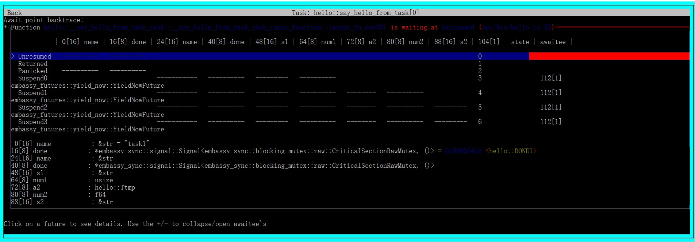
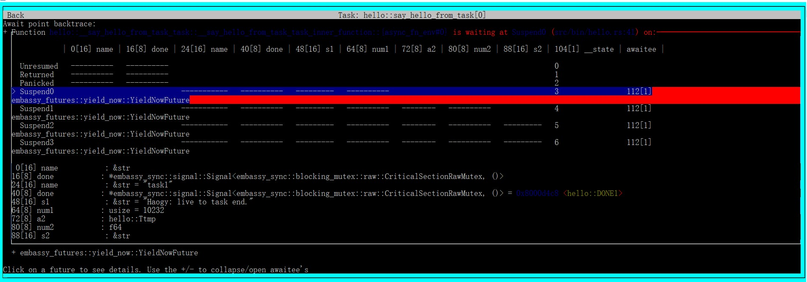
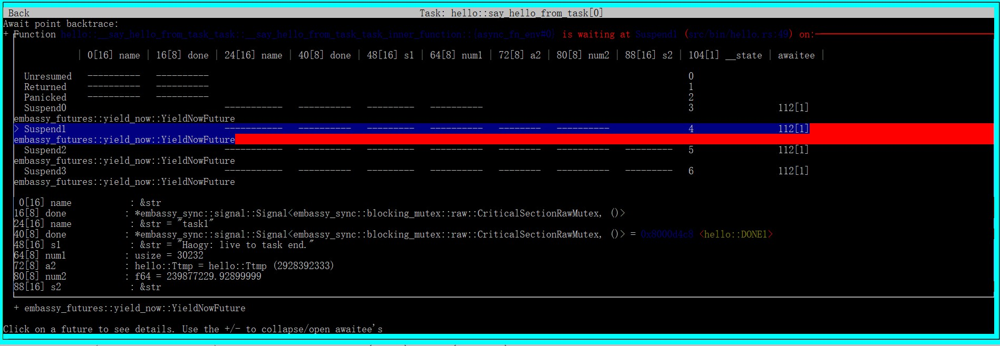
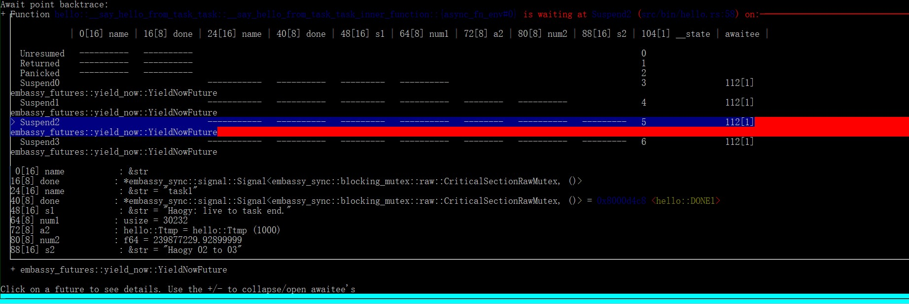
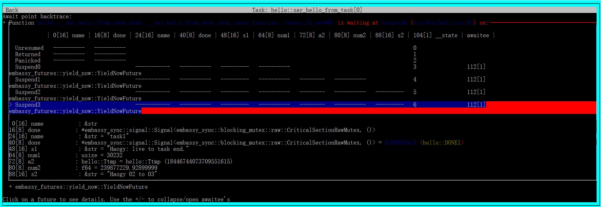
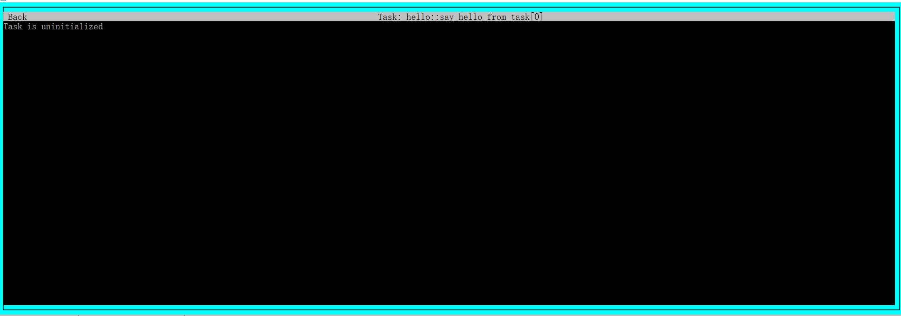
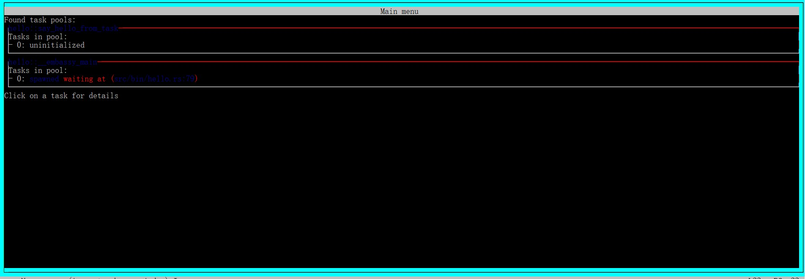
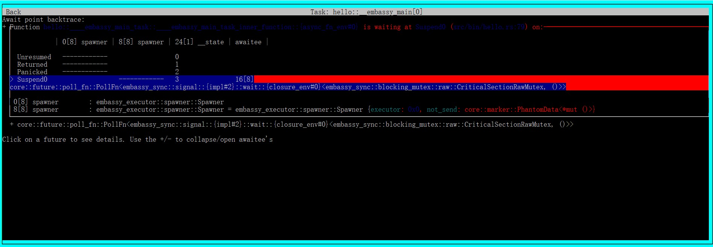

# 1. 动态捕获embassy应用异步状态机状态
1. 使用embassy库中的示例程序`examples/qemu-virt-riscv64/`进行修改作为调试目标。主要是使用yield_now()将say_hello_from_task任务分割为多个阶段，再在各阶段命名一些变量，便于调试时捕获和查看。具体代码如下：
```
#[embassy_executor::task(pool_size = 1)]

async fn say_hello_from_task(name: &'static str, done: &'static Signal<CriticalSectionRawMutex, ()>) {

    println!("Hello from a spawned task!  {}", name);

    let s1 = "Haogy: live to task end.";

    let mut num1: usize = 232;

    // await 01

    yield_now()

        .await;

    let mut a2 = Ttmp::new();


    num1 += 10000;

    let num2 = 239877229.929;

    // await 02

    yield_now()

        .await;

    let s2 = "Haogy 02 to 03";

    num1 += 20000;

    println!("num1 = {}; num2 = {}; {:?}", num1, num2, a2);

    a2.set(2928392333);


    // await 03

    yield_now()

        .await;

    println!("Haogy:  {}", s2);

    a2.set(1000);

    // await 04

    yield_now()

        .await;

    a2.set(usize::MAX);

    println!("End spawned task:  {}, {:?}", s1, a2);

    done.signal(());

}
```

2. 使用启动InspectEmbassy的GDB进行调试，通过GDB的TUI动态捕获异步任务的运行时状态。可以看到InspectEmbassy确实正确捕获了异步任务的内部变量值。具体结果如下：
























# 2. 下周计划

1. 阅读《RT-async 博客》

